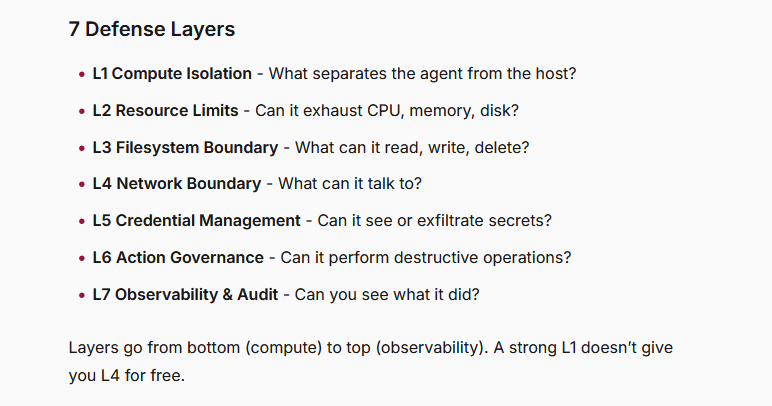

In 2026, AI (LLM) sandboxing is an exhaustive and exhausting ecosystem. The delicate balance of restricting your agents permissions whilst paradoxicially letting them do a lot of privilieged actions. This blog explores numerous sandboxing considerations, the underlying technologies and products/services available on the market today. It's taken days to write, and probably will take days to read.

> <i>As always, thoughts are my own, and do not represent my employer. One of my favourite things about writing a blog, is I can put my ramblings out there, and i dont need to think about structure or audience. This is just an unfiltered braindump of thoughts. Feel free to stick it through an LLM to tidy it up.</i>
{: .prompt-info }

When people say sandboxing, what they *really* mean is a way to let an agent do and indeterminate number of things, but just dont break things, do anything illegal, cost me any money. Basically just do what I would do, but quicker, faster and more securely.

So how do you bake that into your agent, without actually having to think too hard. Many people reach for a sandbox which they think is going to solve all their issues.

This blog post is an exploration of AI sandboxes, starting with the requirements we want from a sandbox, the an overview of the various underlying technologies available, and then some specific product/services in the market.

> **TL;DR** Sandboxing requirements vary significantly depending on context. For local coding agents, off the shelf sandboxing systems may be sufficient, but for cyber-related evaluation environments, an entire *sandbox ecosystem* is required. For the later, building your own is the ultimate solution for maximum control, and likely the only way you can guarantee enough control to satisfty your risk appetite.   Generally, I think we are moving away from a single sandbox, and into a **sandbox harness** which includes a whole suite of distributed security systems. I have a preference for nested defense in depth, leveraging kubernetes (eBPF, Cilium, and Tetragon), nested with gVisor containment with monitoring & observability throughout. This shifts the real challenge into a real-time data processing issue, being able to process millions of *early* signals **across the stack and OSI layers** and make informed, secure and dynamic policy actions. Its the usual detection and prevention control feedback loop, but dialled up to 10.
{: .prompt-info }

<i>This post has been written with the best AI - (Ashley Intelligence)</i>

Luis Cardoso has an [exceptional field guide to sandboxes for AI](https://www.luiscardoso.dev/blog/sandboxes-for-ai). This post is a higher-level extension of his guide, framed in a wider context.

# Contents
* TOC
{:toc}

# Introduction
At the end of September 2026, after the fallout of the Huggingface incident many people were quick to slate OpenAI's lack of security considerations. Obviously the unsupervised chaos that ensued was completely avoidable, but one interesting rebuttal came from on of their [developers on twitter](https://x.com/joedaroo/status/2104335929293127851). Their post entitled "Its not just the f*cking sandbox" captures the many nuances and challenges involving agent evaluation, especially as the scale and fidelity that a frontier lab has to operate. 

> To start with the elephant in the room: yes, sandboxing is important, especially during model training and evaluation. 

> Now, to understand why it is not as simple as "just put it in a sandbox," you have to understand how training and evaluation work in reinforcement learning environments. Typically during an RL run, the model is given some task or objective, an environment in which to execute that task, and then its actions and results are graded. During both training and eval, there are also additional steps such as running tests, collecting outputs, and resetting or reconfiguring environments between rollouts, with backpropagation during training. All of this happens across potentially tens of thousands of different runs at a scale that is hard to comprehend. 

> environment needs to capture the parts of the real world that matter for that task

> More realism does not automatically mean better performance, but leaving out important parts of the task can teach the model behavior that does not hold up in the real world. So we put a lot of work into creating useful, realistic environments, and these environments can be highly complex, highly dynamic, and highly varied.

> To put it lightly, this is non-trivial. Models might need any mix of dynamic compute, network access, the ability to call tools (there could be hundreds of tools!), the ability to download packages, execute subprocesses, spin up subtasks (even on other computers), talk to the internet, use a computer GUI, and any number of other things across an increasingly large set of domains

> You need to think about how to keep the model isolated in this very complex environment while still retaining tool access, 

> On top of that, you need to ask: how do I monitor and understand what the model is doing in potentially thousands of parallel environments? And how do I kill a trajectory when something has gone wrong?

> And yes, if you are talking about the actual sandbox: please use a VM-backed sandbox, for example through Kata or Firecracker (we do!). A conventional shared-kernel container should not be your only isolation boundary for hostile workloads, and I stress and stress and stress to not let this be your only security control.

The scale of their evaluations enourmous, with [Sam Altman commenting](https://x.com/sama/status/2103567198690349362) the volume of telemetry is in a scale of
>  petabytes of agent activity logs

Before we get into it, I'm sharing the above to explicitly call out that headline news of frontier labs performing world-changing evaluations at a never seen before scale produces **its own set of sandboxing requirements which might not directly translate to your local coding agent use case** (e.g. concerns claude code agent having permissions to read your mailbox).

# What is a sandbox?
Before the AI revolution, I used to build cyber-security labs and ranges for a living. I always considered those environments a sandbox, a self-contained environment where users could learn and upskill without harming anything.

I restricted web access to specific websites, locked down general network connectivity, and used least-privilege access in VMs and containers to stop users cheating. I monitored audit logs, set up automated alerting and reporting, made admin permissions explicit opt-in, and added policy-based permissions models. The focus then was to stop users cheating, stop excessive cost, and provide a safe space for learning and experimentation.

The [Oxford dictionary](https://www.oxfordlearnersdictionaries.com/definition/english/sandbox_1) defines a sandbox as "a test area on a computer system, where you can run software without affecting the hardware or other software". I think that holds up really well.

Nowadays, when I see people talking about sandboxes, it's nearly always in the context of running an agent, rather than a human getting to "play in a sandbox". Other contexts might be a reverse engineering workstation, or a forensic investigation environment. Our own experiences and use case influence how we think about sandboxes, and what our requirements are.

## What do the authorities say?
A quick glance at how leading technical authorities define this contentious term. Some of these are in the context of their own products (e.g. claude code), rather than general terms.

| Company | Definition | Notes | Reference |
|---------|------------|-------|-----------|
| OpenAI | Run agent work in a container-based environment with files, commands, packages, ports, snapshots, and resumable state. A sandbox gives an agent an isolated, Unix-like execution environment with a filesystem, shell, installed packages, mounted data, exposed ports, snapshots, and controlled access to external systems. | A super pescriptive defintion. | [https://developers.openai.com/api/docs/guides/agents/sandboxes](https://developers.openai.com/api/docs/guides/agents/sandboxes) |
| Anthropic | pre-defined boundaries within which Claude can work more freely | focus on two boundaries: filesystem isolation and network isolation. | [Claude Code sandboxing](https://www.anthropic.com/research/claude-code-sandboxing#:~:text=Code%2E-,Sandboxing%3A%20a%20safer%20and%20more%20autonomous%20approach) |
| Google |  ...where untrusted, LLM-generated code must execute in an isolated environment | A distinction here is explicit keywords around "execution" and "isolation". | Google's [agent sandbox on GKE](https://docs.cloud.google.com/kubernetes-engine/docs/concepts/machine-learning/agent-sandbox#limitations) |
| Vercel | isolated compute environments for running untrusted code, testing applications, executing AI-generated scripts, and more | Clear on isolation, but describes Vercel’s Linux-based setup rather than sandboxes generally. | [Understanding Sandboxes](https://vercel.com/docs/sandbox/concepts) |
| Cloudflare | A sandbox is an isolated place to run code. The code cannot directly read the memory or data of your application. Your Worker decides which application APIs and data the code receives, and whether the code can reach the public Internet.| Specific to running code and internet-acccess | [Sandboxes on Cloudflare](https://developers.cloudflare.com/sandbox/)

## My definition
At its highest level, I think an "AI Sandbox", is an isolated execution environment with configurable controls that define and enforce the operating boundaries of workloads.

By controls, I mean the ability to enforce specific limitations on what a workload can and cannot do.

By operating boundry, I mean that the sandbox needs to be able to do its job in order to be useful. I dont necessarily want to cripple my agents capability to perform is job, but I do want the ability to put it in a straightjacket if i want. So its not just about the specific low level technical controls I can implement, but more about making the agent useful.

# Things I want to see in a sandbox ecosystem
Subtly different from the definition, is the requirements that I have for a sandbox. **These change with the context.**Am i running an evaluation? am i generating code? Am i reviewing internal process documents? Am I performing internal or external cyber security work? Its not a one shoe fits all.

There's also a distinction between **a single agent running on my PC** and **an agent swarm running on an infrastructure harness**.

For the following requirements, I'm mostly thinking about the more conservative evaluation use case. I wouldn't necessarily apply all of them to an agent helping me write code on my laptop. I'm assuming virtualised or containerised workloads, either on my PC or in the cloud. I'm not designing a dedicated physical lab with access to server racks.

It's also tricky deciding what counts as part of the sandbox. Is a credential proxy part of it, or part of a "sandbox harness" where multiple technologies work together to provide the desired functionality?

For now, I'm interested in thinking about everything. Whether a requirement is delivered by the execution environment or something around it matters when implementing it.

******

[Georgebuilds has published a decent taxonomy for agent sandboxing](https://georgebuilds.dev/blog/agent-sandbox-taxonomy/). He breaks it into seven defence layers, with a scoring matrix for comparing what different products provide. Unfortunately it reads heavily LLM generated, so it needs finessing, which i'll attempt to do.

I'm going to borrow those headings to work through my own requirements. For L5, I'll broaden credential management to "data protection", because there are other assets I'd want to include. I'm not trying to rescore the products or replace his taxonomy. I want to explore what I need from the whole setup, using those controls as a starting point.

I think these are a little low-level and restrictve in their taxonomy, i'd suggest something more high level first as an introduction, and then potentially breaking into these technical varients for the specific product mapping, which is the original intention.

<b>Click here to see my thoughts about each of these layers and the types of things I'd expect to be able to catch (~15 minute read)</b>

## Sandbox Taxonomy
I'm trying to not repeat what [George has already covered](https://github.com/kajogo777/the-agent-sandbox-taxonomy), but supplement with additional opinions based on the context described above.

### L1 Compute Isolation
This is the fundamental requirement, without this these sandboxes are useless. I essentially need to run workloads, which require compute. When i say compute, I mean allocated memory, disk and processing that is useable for whatever workload I need to run - agentic or not.

When i say isolation, i explicitly mean being strict sepereation so activity on one isolated environment cannot access, change or disrupt another.

The real *requirement* here is multi-tenancy. Shared hardware (resources) used by multiple "customers", with logical seperation.

Something that I find is often overlooked, is the van-eck and tempest type attacks, which look to break this isolation. These are sophisticated attacks, but we should remain vigilant and model these threats, especially if the use case is model evaluations.

This might fuel a requirement for a **dedicated** machine and resources, as opposed to shared or spot instances that cloud providers offer by default.
 
### L2 Resource Limits
Memory leaks or excessive resource consumption can cause denial of service on the host and affect other users.

I want to limit the resources available to each sandbox, whether that's disk space, memory allocation or CPU.

I have a bonus requirement for elasticity. If I'm running a swarm of agents, I want the surrounding infrastructure to grow and scale without manual intervention, within limits I've chosen.

Essentially I'm am essentially describing the cloud and kubernetes deployments, with requriements to avoid noisy-neighbor and to have elastictity in my sandboxes.
#### L3 Filesystem boundary
I'd like to control specifically which files a workload can access within the sandbox, and what it can do to them.

I don't want this to imply that I first need a complicated agent identity system. There still needs to be an enforcement context, but that might be the process, the container or the entire sandbox rather than an individually identified agent.

I want to block "workloads" (intentionally vague) to having access to certain files. this might be the ssh keys, or cached offline credenitals, or drivers.

I also want to track file creation, modification and deletion. Suspicious extensions could be an example of the type of thing I'd want to look our for.
### L4 Network Boundary
Arguably, this is one of the most important boundaries to secure, with some of the trickiest controls to get right. If an agent can spin up another execution environment outside the systems I control and carry on working there, I've lost a significant control.

Networking controls need to go beyond just the OSI network layer. I'd like to see fine-grained control from the data link layer right up to the application layer. That means filtering IPv4 and IPv6 traffic, setting rules for TCP and UDP, and applying application-level controls to services like HTTP and HTTPS. If the workload can access a data-link interface, I'd want controls there too, including MAC address filtering. I'd also want DNS filtering and TLS inspection where it's supported and appropriate. If someone connects in or out over SSH or RDP, or anything else, I want to know about it. I'd want a deny by default, and slowly ease allowlist certain items as I figure out what are reasonable permissions.

Last month, [someone posted on reddit ](https://www.reddit.com/r/webdev/comments/1wwyawv/til_that_you_can_connect_to_ipv4_addresses_like/) that you can represent private IPs in decimal form in a browser which blew my mind.  E.g. instead of going to `192.168.1.1`, you could use it's decimal form: `3232235777`. This highlights one of the many issues with  traditonal IP matching filters.

Then there's stateful versus stateless filtering. Stateful filtering keeps track of connections and recognises traffic belonging to an established session; stateless filtering checks each packet against the rules without that context. I kinda want the capability for both.

It's important to remember that *allowing a port* isn't the same as knowing what its used for. Just because port 21 is reserved for FTP, dosent mean thats what its being used for. I'd want the ability to determine if a port is being used as I expect. What if an agent makes up its *own* protocol and starts using that? I'd want to know. That means a stricter processing on the low level networking protocols at the TCP/UDP layers.

I'd want to account for tunnels. Tools such as chisel, socat and iptables enable a bunch of network kung-fu. I'd take the [Cyber Plumber's Handbook](https://github.com/opsdisk/the_cyber_plumbers_handbook) and check what my controls can actually prevent or observe.

Dont forget about DNS-based exfiltration, where otherwise allowed traffic can be used to move data or reach services I never intended to allow. This post (which is nearly 10 years old!!!) [Using DNS to Break Out of Isolated Networks in a AWS Cloud Environment](https://dejandayoff.com/using-dns-to-break-out-of-isolated-networks-in-a-aws-cloud-environment/). His test instance had no internet gateway or NAT route and no outbound security-group rules, but could still query AWS’s default resolver, AmazonProvidedDNS, because that traffic bypasses security-group filtering. He tunnelled network traffic through DNS and successfully reached an external website, showing a path that could also carry stolen data. So even blocking ordinary outbound connections does not guarantee isolation, you really need DNS monitoring.

In 2020, I [blogged about domain name categorization](https://akingscote.co.uk/posts/domain-categorisation-finance-reactjs-site/). I know that some corporate filters block domains based on their catagory. The specific example that triggered my experience was that finance related websites werent subjected to TLS inspection, but others were. I think any domain name filtering, should ignore any category information. 

Then there are things like port knocking. If my sandbox starts making unusual sequences of connection attempts to a target, especially across closed ports, I'd want to track and monitor those patterns.

I also want the ability to dump my TCP/UDP traffic to something like a PCAP, or ng-pcap (next generation PCAP), allowing for my other agents/traditional tooling to process. I would want all network dumps to not contain any encryted traffic, unless i had the *easy* ability to decrypt it.

These are deliberately specific examples, and ther are *sooooo* many more. But these are some of the things I'd want to test when someone tells me their sandbox has "network isolation".

*****

Deny by default is the obvious starting point here. If my *preventative* (primary) controls arent enough, I want to ensure i have comprehensive *detection* controls. Ideally with a feedback loop, so my detections fuel further preventative controls. None of this is new, but the *context* to which its applied is (AI). Even in the most secure sandboxed environment, is it unreasable to treat these models as (actual) super intelligence and assume it can and will break out?

If I'm monitoring all this activity, and the vast amount of signals I'd need to process in real time, can my detection to prevention control pipeline act quickly enough to stop an exfiltration? One permitted request might already be enough.

The easy answer is to stop all outside access, but what if you need outside access. What if youre triyng to run an authorized red teaming activity against Salesfoce? Mocks are the easy answer, but youre never going to have true fidelity unless you run against the real thing. Is the risk of that extra fidelity worth any additional insights and assurances you might gain.

What if I'm running an authorised red-team activity against Salesforce? Mocks are an easy answer, but they won't necessarily give me the fidelity of the real thing. Is the extra fidelity worth the additional risk, and what extra insight am I actually getting?

Open AI recently (23rd October 2026) talked about their [new approach to model containment](https://openai.com/index/securing-our-frontier-model-training-environment/#:~:text=Our%20new%20approach%20to%20model%20containment,-Our), and how they essentially have "mocked the internet".

### L5 ~~Credential management~~ Data protection
I'd frame this as a more generic data protection, credential management seems oddly specific, perhaps written for the coding agent perspective.

Rather than starting with secrets (credentials?), I'd instead ask:  "what assets would I want to protect that a sandbox might use" That could mean credentials, source code, customer data or anything else I don't want exposed or modified. Then I'd work backwards from those assets to the controls they need.

With that approach, I need a mechanism to give the "workload" permissions, and the ability to say what it can and cannot access.  For each asset, I need to decide what the workload can read, modify or pass elsewhere. Data might live in files, memory or external services, so this isn't just a filesystem problem, its anything that can store data.

**Im trying to explore here the relationships behind binding digital resources to a *thing*. once that problem is solved, adding in access controls is much simpler in comparison. So this section takes a detour and explores <u>identities</u> as a foundational building block which would allow data-level protection controls to be implemented.**

The bit I'm interested in is the binding. How do you tie a digital identity to the thing it's supposed to represent? Is a certificate the identity, or a signed claim about it? Is a password the identity, or just a credential that lets something authenticate as it? And is proof of possession a strong enough binding? The certificate isnt the thing, the workload is the thing.

I remember conversations about this years ago, and it reminds me of [Self-Sovereign Identity](https://did-map-resources.s3.amazonaws.com/SSI+Book/Alex+Preukschat%2C+Drummond+Reed+-+Self-Sovereign+Identity_+Decentralized+digital+identity+and+verifiable+credentials+(2021%2C+Manning+Publications)+-+libgen.li.pdf), with its emphasis on controlling digital identities and presenting portable, verifiable credentials. But verifying a credential isn't the same as trusting everything it says. Someone still has to decide which issuers and claims they trust.

With agents, that binding gets interesting. Am I identifying a logical agent, a particular running instance, the workload hosting it, or the entire swarm? If it restarts, forks or moves somewhere else, is it still the same thing? And should it still have the same authority?

There's also the question of whose authority it's using. Is the agent acting independently, or on behalf of a human? If it delegates work to another agent, what permissions should travel with that delegation? [Microsoft's Entra Agent ID](https://learn.microsoft.com/en-us/entra/agent-id/what-is-microsoft-entra-agent-id) is one example of work in this area, giving agents governed identities and linking them to human owners and sponsors.

I don't think we need a software equivalent of human biometrics. Workloads already have ways to authenticate using keys and short-lived credentials. Trusted infrastructure can also use attestation to help establish which workload is requesting those credentials, rather than relying on a behavioural fingerprint. Getting that binding right gives access controls something concrete to attach to. But knowing which agent made a request doesn't automatically tell me whether the request should be allowed, or whether the agent has been compromised.

In thinking about these data requirements, it makes me think taht the sandbox isolation requirements morph into a 1:1 mapping for a sandbox and an execution workload. Rather than a long-lived complex thing, that needs strong acxcess control. I might want to give access to one element of teh workload, but not another. In teh context of agentic workload,s this is super complex because agents are dynamic.

If we assume the shared resources and compute, then there will ened to be a mechanism to exchange information between sandboxes. This *then* might circle back to the identity and trust relationship problem, and verifiable credentials (authentication) and authorization.

### L6 Action Governance
George's definition here focused on whether the agent can perform descructive or unathorized operations.

As explored, as we move up the stack and think about descructive controls like "dont delete my remote github code", that requires an identity, and policy and enforcement of that policy. That then branches requirements for policy owernship, accountability, oversight, review and auditing.

You could decouple that agent requirement, and think of it just as a sandbox with general policy controls. E.g. SeLinux, AppArmour, OpenPolicy engine, seccomp etc...

I'd also want to manage and track the actions of the agent, so that i could track attempts for lateral movement. that could mean anything, either for a website its connected to like azure, or local permissions, or external operating system its ssh'd rdp'd too.

I want deny by default.

[George's definition here](https://github.com/kajogo777/the-agent-sandbox-taxonomy#l6--action-governance) focuses on whether the agent can perform destructive or unauthorised operations. The distinction is that an agent might have legitimate access to a resource, but that doesn't mean every action it could perform should be allowed.

"Don't delete my remote GitHub repo" is a different requirement from "don't connect to GitHub". I might want the agent to read the repo or propose changes, without allowing it to delete the repo, change permissions or overwrite protected branches.

Identity can help determine whose permissions apply, but I also need policy and somewhere to enforce it. That enforcement might sit in the service itself, a tool gateway or a trusted broker. The important bit is that the agent can't bypass the decision by switching tools or making the same request directly.

This doesn't have to be an agent-specific problem. You could treat the sandbox as a workload operating under general policy controls. SELinux, AppArmor and seccomp can restrict what happens locally, but they don't understand the meaning of a remote GitHub operation. A policy engine such as Open Policy Agent could help evaluate that operation, provided the enforcement point supplies the relevant context and honours the decision.

Then there are the governance requirements around those policies. Who owns them? Who can change them? Which actions need explicit approval? For higher-risk operations, I'd want approval tied to the actual action and target, rather than a blanket approval for whatever the agent does next. And that system itself needs monitoring and auditing and RBAC... Is that part of a sandbox? or a sandbox harness/ecosystem?

I'd also want controls against lateral movement and privilege escalation, whether that's accessing another Azure resource, gaining additional local permissions or moving onto another machine over SSH or RDP. Once an agent is working remotely, the local sandbox doesn't automatically govern its actions there. Those controls need to exist at the destination or an appropriate enforcement point too.

I'd want a record of policy decisions, approvals and denied attempts but it needs to connect back to the rules being enforced here. Another examples of the preventative and detective policy pipeline.

### L7 ~~Observability & Audit~~ Monitoring, Observability & Auditing
As I've covered in [previous blogs](https://akingscote.co.uk/posts/observability-in-a-nutshell/), I'm a little pedantic about security monitoring versus observability. They overlap, but I wouldn't use the terms interchangeably. I've split this section into monitoring, observability and auditing.

To me, observability means having enough telemetry to ask questions I didn't anticipate, then slice and dice that data to understand what's happening at runtime. Security monitoring is more focused on detecting activity I care about like suspicious behaviour, policy violations and events that need investigation.

Auditing is about keeping a durable, attributable record of who or what did something, where, when, and with what outcome. Where possible, I'd also want the context behind it, which request triggered the action, which policy applied, and who approved it.

George gives this its own dimension in the scoring matrix, which makes sense for comparing implementations. In practice, though, I'd want it embedded throughout the other controls. Every boundary should produce evidence about what crossed it, what was allowed or denied, and what actually happened.

I'd want network flows, traces, metrics and logs, including process trees and relevant system calls. The interesting bit is joining them together, and in real time for an emergency policy creation.

For example, I'd want to trace a network request back through the process and tool invocation to the agent task and conversation context that caused it. Or trace a file being opened back to the process that opened it, its parent processes, and the workload responsible.

I'd rather not reconstruct all of that from timestamps alone. I'd want explicit correlation using workload, session, task and trace identifiers, with trusted instrumentation (obersvability) connecting those identifiers.

The workload mustn't be able to disable collection, change the policies governing it, or erase the only copy of the evidence. Logs kept solely inside the sandbox aren't enough; authoritative records need to be retained outside its control. It would be great if I could build up a picture of normal activity for a particular workload and compare that with its behaviour at runtime. 

So this is all about producing the prevention <-> detection feedback loop.  Telemetry feeds detection, detection informs a policy decision, and that decision might block an action, request human approval or pause execution. 

I'd also want to pause local execution and preserve relevant state for investigation, where the platform supports it. That could provide a useful forensic capability alongside the historical events. But pausing a sandbox doesn't undo an action or necessarily stop work already dispatched to another system. Filesystem snapshots and captured memory or process state also provide different kinds of evidence. So there are potential *forensic integrity* requirements muddled in here as well.

Then there are agent-specific signals like prompt injection, context bombs, possible hallucinations or misaligned behaviour. You'd need to get that context context from runtime or inference gateway. So the signals that need correlating are likely distributed. Again, these sandboxes are all context specific.

 Many of these "requirements" are general cloud-computing requirements. Multi-tenancy, resource quotas, access control, telemetry and policy enforcement...
Working through George's headings has been useful to get me thinking. But they are a little low-level for what I'm now trying to describe, and for a different purpose (scoring sandbox technologoies).

Conversly, [Luis cardoso](https://www.luiscardoso.dev/blog/sandboxes-for-ai) splits a sandbox into three decisions:
- boundary - where isolation is enforced
- policy - what the code can touch inside the boundary
- lifecycle - what persists between runs, which affects both agents and RL

He derives a *different* definiton of a sandbox:
- Sandbox: boundary + policy + lifecycle.
- Runtime sandbox: isolation enforced by a runtime (Wasm, V8 isolates) rather than the OS.

# Sandbox Technologoies
With all the above in mind, I'd like to try and simplify and explain some of the common primitives, core technologies and the various products/services that exist on the market. I'm going to avoid a detailed exploration of some of these items, as [Luis' great blog](https://www.luiscardoso.dev/blog/sandboxes-for-ai) covers that.

Here is a bunch of the sandbox-related items *that I know about*. I've not actively researched any new items, so this list is no way exhaustive.

## Primitives
Before we dive into sandboxing technologies, let me try and provide some baseline knowledge and alignment around the underlying technologies.

### Computers 101
Lets start with understanding *computers* at a high level. Computers take inputs, processess them, optionally stores data, and produce output. Decades of engineering make it all appear as magic. Watch this [fantastic video on making logic gates from transistors](https://www.youtube.com/watch?v=sTu3LwpF6XI), and you can see how basic electronics set the scene for programmable computers.

But in real terms, you need processing hardware, memory and storage to bundle together as *compute*.

The CPU runs machine code which are instructions encoded in binary. Physically, these are electrical signals, typically low and high voltage levels. That takes us back to the logic gates in [Ben Eater's video](https://www.youtube.com/watch?v=sTu3LwpF6XI). Gates process those signals using rules like AND, OR and NOT. The CPU combines them into circuits that decode instructions, add values and move data around. Assembly language gives us a readable way to write those instructions. An assembler converts it into machine code. Compilers can also produce machine code from higher-level languages.

On a typical PC, switching the power on starts firmware, stored in a flash-memory chip on the motherboard. It keeps its contents when the power is off. Older PCs used BIOS firmware; modern PCs usually use UEFI firmware, although people often still call it all "the BIOS".

The firmware prepares the hardware and runs basic startup checks (POST - Power-On Self-Test). It then starts the bootloader, which loads the operating system's kernel into memory (RAM) and starts it running. RAM is the fast working memory holding the code and data currently **in use**.

The kernel manages CPU time, memory and devices. Applications normally run in user space, using interfaces to request resources. The operating system includes the kernel, libraries, services and other software around it. For example, an application reading a USB drive asks the operating system. The kernel handles the request using filesystem code and drivers that communicate with the hardware.

**CPU architectures and systems-on-chip**
Architectures such as x86-64 and ARM define different instruction sets. Machine code built for one doesn't generally run directly on the other without translation or emulation. A system-on-chip, or SoC, integrates components such as CPU cores, graphics, memory controllers and device interfaces into one chip. The main RAM can still be separate.

**Secure Boot and the root of trust**
Secure Boot checks boot software against approved signing certificates or hashes before allowing it to run. The bootloader can continue those checks into the kernel and other startup components, creating a chain of trust. That chain needs a starting point we already trust, such as protected startup code and keys. That's the **root of trust**. A Trusted Platform Module (TPM) can securely store keys and support a "secure boot".

So now we have a basic understanding of these key terms:

- Memory
- Processing
- Bootloaders
- CPU (and CPU architectrures)
- Kernels
- Operating systems

### CPU virtualisation
Some virtualization technologies need help from the CPU itself. *Hardware-assisted* virtualisation uses processor capabilities such as Intel VT-x and AMD-V. These let a hypervisor run guest operating systems efficiently while retaining control over privileged operations and access to hardware.

### Windows and Unix (and Linux)
Unix started as an operating system designed for multiple people and programs to share a computer. It grew into a family of systems built around processes, files and permissions, with a tradition of small tools that can be combined to do bigger jobs. The "everything is a file" idea comes from here. Many resources, including devices, pipes and sockets, can be accessed through file-like interfaces which gives programs a consistent way to interact with things.

Linux follows those Unix conventions, but its kernel was developed independently. It's Unix-like, rather than derived from the original Unix code. The kernel is open source, and distributions such as Ubuntu combine it with libraries, tools and services to make a usable operating system.

macOS is also Unix-based, but it uses a different kernel from Linux. Parts of its foundation are open source, while much of the wider platform is proprietary. Despite  terminal commands, that dosent mean it has the same underlying kernel features.

Windows takes a different approach, with its own application interfaces, permissions model and ways of managing resources. It's largely proprietary, with an emphasis on an integrated Windows platform and keeping existing applications working. Windows applications commonly useDynamic-Link Libraries (DLLs) which are reusable code loaded into an application's process. Linux has a similar mechanism through shared libraries, typically `.so` files.

So these are different operating-system architectures, not necessarily different CPU architectures. That's why a control provided by the Linux kernel isn't automatically available on Windows or macOS.

### Virtualisation versus Emulation
Virtualisation gives an operating system a virtual view of physical resources. With hardware-assisted CPU virtualisation, compatible guest instructions run on the real CPU under controlled conditions.

Emulation however recreates hardware behaviour in software, including the CPU. That lets an x86-64 PC run instructions intended for an Arm machine, although it's generally slower.

#### QEMU
[QEMU](https://www.qemu.org/) (quick emulator) is a full-system emulation engine that can support either. It can emulate a machine's CPU, memory and devices, or use the host's hardware virtualisation support. It can also mix approaches: virtualising the CPU while emulating devices. 

An easy way to remember it, is emulation *emulates* the hardware and evertything beyond it. Virtualisation is just the kernel and operating system layers.

### Virtual Machines
A virtual machine (VM) is essentially a computer withiun a computer. It uses virtual CPU, memory and devices. The operating system running inside it is the "guest OS", and its kernel is the "guest kernel".

A Virtual Machine Monitor (VMM) is software that runs and controls VMs. **Hypervisor** is another term used for the virtualisation layer, particularly the mechanisms controlling guest execution and isolation. The terms often overlap.

The general arrangement looks like this:

Physical CPU, memory and devices (host)
└─ Virtualisation layer
   ├─ VM 1: guest kernel + guest applications
   ├─ VM 2: guest kernel + guest applications
   └─ VM 3: guest kernel + guest applications

Each VM runs a **separate guest kernel**, even if they boot the same OS image. They share physical resources, not a guest kernel. 

**Linux - Kernel Virtual Machines (KVM)**
KVM is a **Linux kernel feature** (we will be talking about linux kernel features a lot!) that lets Linux act as a hypervisor. It uses the CPU's hardware virtualisation capabilities to run guests and control their access to memory. Linux-based dosent mean that it can only boot linux VMs.

**Windows - Hyper-V**
The native Windows counterpart is [Hyper-V](https://learn.microsoft.com/en-us/windows-server/virtualization/hyper-v/architecture), although its architecture differs from KVM. Hyper-V runs beneath Windows. Windows runs in a privileged management environment, called the root partition, which manages devices and creates the guest VMs. Each guest runs its own kernel. QEMU can use the Windows Hypervisor Platform, an API exposing Microsoft's hypervisor capabilities, rather than KVM.

**macOS: Apple's virtualisation frameworks**
macOS isnt Linux based, and doesn't provide KVM natively. Apple supplies [Hypervisor.framework](https://developer.apple.com/documentation/hypervisor) for low-level control of virtual CPUs and memory, and [Virtualization.framework](https://developer.apple.com/documentation/virtualization) for higher-level VM configuration, devices and lifecycle management. An application running on macOS uses those interfaces to allocate resources and start a guest OS. 

**Virtual machines need to use a machine which has a CPU with the virtualization hardware-assisted capability enabled.** (excluding QEMU emulation ofc)

### Trusted Exection Environment
A Trusted Execution Environment (TEE) provides a protected environment for code and data while they're being used. Hardware-backed TEEs can restrict access from surrounding software which could include the OS or hypervisor.

TEEs are primarily found in System on Chips. Many ARM-based SoCs include *TrustZone* which is ahardware security architecture separating secure and non-secure execution. Software in the secure world uses that separation to protect sensitive operations from the normal operating system.

[OP-TEE](https://optee.readthedocs.io/en/latest/general/about.html) (open portable) is an open-source implementation, normally using Arm TrustZone, so its tied to ARM CPU architectures. It's software implementing a hardware-backed environment. But you can also run [OP-TEE under QEMU](https://optee.readthedocs.io/en/latest/building/devices/qemu.html), *emulating* an ARM system and its secure/non-secure worlds. That's useful for developing trusted mobile or embedded components on a normal PC for interoperability. But a software-emulated TEE is a development environment. Its host can inspect or alter the simulation, so it doesn't provide the same hardware-backed protection or attestation guarantees as the real device.

The secure boot, trust zone information is interesting, but it necessarily help with agent sandboxing. Protecting an agent from its surroundings isn't the same as protecting those surroundings from the agent.

### Containers
I want all readers to make a concrete connection between containers and Linux. **Containers adoption is significantly the Linux-based type**. Mainly because of how lightweight linux environments are, allowing for fast and interoperable transfer and utilisation.

The whole world runs on containers and kubernetes, but not many people take the time to understand how they work under the hood. I strongly recommend checking out [Liz Rice's Container Security book](https://www.oreilly.com/library/view/container-security/9781492056690/).

**A smidge of history and context...**
Containers bundle memory, CPU, disk, processes and networking into a self-contained and isolated environment. They do this by leveraging the underling **linux namespace** and **cgroups** functionality. Forget about Docker for now, lets focus on just containers as a technology, and then we will talk about container runtimes.

[Linux namespaces](https://man7.org/linux/man-pages/man7/namespaces.7.html) are a Linux kernel capability that gives processes separate views of system resources. A process can see just its own process IDs, filesystem mounts, hostname and network interfaces. [cgroups](https://man7.org/linux/man-pages/man7/cgroups.7.html) (control groups) are another Linux kernel capability. They group processes so the kernel can account for and control their resource usage.

The useful distinction is:
- namespaces separate views
- cgroups control resource consumption

These two technologies together are the main engine behind containers.

**Containers and container runtimes**
So containers are essentially bundles of process/memory/networking/CPU provided by those Linux kernel technologies. That means containers all run on the same kernel. Compare this to a VM, where each VM gets its own guest kernel, containers share the Linux kernel they run on. 

A *container image* is the packaged filesystem and configuration used to create containers, making applications straightforward to share, distribute and run.

A *container runtime* is software that creates, starts, stops and manages container execution. It sets up the isolation and resource controls (either directly or through another lower-level runtime) and then starts the application's processes.

A *container engine* is software for building and managing container images, and creating, running and managing containers through an underlying runtime.

`Docker` popularised this model by making containers straightforward to build, distribute and run. When most people think of containers, they think of Docker.

`Docker Engine` is the broader container-management software. Its background service receives commands from the [docker CLI](https://www.docker.com/products/cli/) (e.g. `docker run`) Underneath, Docker uses `containerd` to manage container execution.

[containerd](https://containerd.io/) is a container runtime daemon tat manages images and container lifecycles. It normally delegates to a lower-level runtime called `runc`.

`podman` is an alternative container engine for building, distributing and running containers. Unlike Docker Engine, it doesn't require a central daemon on Linux. It uses lower-level runtimes like `runc` instead of going through `containerd`.

[runc](https://github.com/opencontainers/runc) the most common low-level Linux container runtime which underpins most of the above. It acutally sets up the namespaces, resource controls etc.. 

**Docker containers on Windows and macOS**
Windows and macOs doesn't have the Linux kernel capabilities described above. So Docker Desktop fires up Linux VM, and *then* runs the linux containers in there and presents them to the windows environment.

Containers aren't *exclusively* a Linux concept. Windows also supports [Windows containers](https://learn.microsoft.com/en-us/virtualization/windowscontainers/about/), using Windows kernel mechanisms, but those are different from running Linux containers through Docker Desktop and are less interoperable and much less common.

## Core Technologies
So now lets explore some core and common technologies that are leveraged in the world of AI sandboxing, that build upon those primatives (excluding TEEs, I was just sharing that because its interesting).

### MicroVMs
A microVM is a super lightweight VM with most of the functionaltiy and utiltiies stripped out, designed for fast startup and low resource overhead. hey are used for single-purpose, ephemeral workloads, but they still run their own guest kernel.

They typically use lightweight filesystems like [busybox](https://busybox.net/about.html) which provide slimmed-down versions of common command-line utilities for a tiny overhead. You might find that a familiar command exists, but certain flags are missing 

**MicroVMs are just a general term to describe super lightweight VMs, and not any specific underlying technology.**

#### Firecracker (linux)
Firecracker is an open source VMM  <tool> developed by AWS. It powers their AWS Lambda and Fargate (container) services. It uses KVM on Linux to create and run microVMs. It strips back unnecessary devices and guest-facing functionality to reduce startup time, memory overhead and attack surface.

### eBPF
[eBPF](https://ebpf.io/what-is-ebpf/) (extended Berkeley Packet Filter) is *another* Linux kernel capability. It lets us load small programs that run inside the kernel, without rebuilding it or loading a traditional kernel module.

It grew out of Berkeley Packet Filter, originally used for filtering network packets, but now supports much more like tracing application behaviour, investigating performance, networking and security controls. The [foundational changes can be found in this original commit](https://github.com/torvalds/linux/commit/bd4cf0ed331a275e9bf5a49e6d0fd55dffc551b8).

The basic idea is to attach a small program to a **hook**, a point where the kernel can invoke it when something happens. That could be a process starting, a system call being made or a network packet arriving. 

Once attached, the kernel runs the program whenever that hook is invoked. The overhead can be low because programs run directly in the kernel, usually as compiled machine code. Essentially this results in a low overhead mechanism to monitor and affect super low level functionality without running anything in the userpace.

For sandboxing, this could provide significant new visibility into what workloads are actually doing, and places to enforce certain controls. Workloads are **already** using these endpoints, eBPF just essentially attaches a listener to it. Useful exmaples include: system calls, process creation, file access and network activity.

### Cloud Hypervisor
[Cloud Hypervisor](https://www.cloudhypervisor.org/) is an open-source virtual machine monitor (VMM). Despite the name, it doesn’t replace the underlying hypervisorm, it uses KVM or Microsoft's hypervisor through to provide hardware-assisted virtualisation.

Compared with a general-purpose VMM like QEMU, it focuses on modern operating systems. Each VM still gets its own guest kernel.

### Kata containers
[Kata Containers](https://github.com/kata-containers/kata-containers) is a container runtime that runs containers inside lightweight VMs. Unlike a standard `runc` container, the application processes run against a **guest Linux kernel**. So we are getting layerd isolation.

Kata integrates with `containerd` and kubernetes and uses a VMM such as Cloud Hypervisor or QEMU underneath. So you keep familiar container images but introduce a VM boundary between the workload and the host. So its a little slower than to startup than containers, but you get that added isolation.

[Azure AKS pod sandboxing](https://learn.microsoft.com/en-us/azure/aks/use-pod-sandboxing) combine Kata Containers with [Cloud Hypervisor]( https://www.cloudhypervisor.org/).

### Bubblewrap (Linux)
[Bubblewrap](https://github.com/containers/bubblewrap) is a process sandboxing tool. It uses Linux namespaces to construct a restricted environment around an application.

You choose which filesystem paths to expose and whether to isolate things like networking and process IDs. Its not "containers" specifically as it dosent ahve the whole distribution and lifecycle management.

### Seatbelt (macOS)
[Seatbelt](https://github.com/chromium/chromium/blob/main/sandbox/mac/README.md) is macOS's process sandboxing mechanism. It applies policies that restrict what a process can access, including files, networking and operating-system services.

Like Bubblewrap, it restricts processes rather than creating a separate machine. The application still shares the host’s macOS kernel though, so you dont have the same level of isolation.

### gVisor
gVisor have some strong opinions about sandboxing:
- ["Containers are not a sandbox."](https://github.com/google/gvisor/blob/f51a205a8f4afbc5ab41aded070df74951b081ea/
README.md#what-isnt-gvisor) 
- "using a single, shared kernel ... means that container escape is possible with a single vulnerability."

With a standard Linux container, application system calls still go to the host kernel. [gVisor](https://gvisor.dev/docs/) changes that by introducing a userspace application kernel called the Sentry. Rather than booting a full guest Linux kernel it implements Linux functionality in userspace and handles the application';s system calls there. The important distinction is who controls access to the host kernel. The application interacts with the Sentry, which performs the underlying host operations through a restricted interface. The host kernel is still involved, but much less of its syscall interface is directly exposed to the workload.

gVisor's runtime `runsc`, integrates with Docker, `containerd` and Kubernetes. So you can keep your usual container images and workflows while adding a different isolation boundary underneath.

The trade-off is compatibility and performance. Not every Linux feature is implemented in gvisor and workloads that make lots of system calls can pay more overhead. 

This [post from reddit](https://www.reddit.com/r/docker/comments/1fmuv5b/kata_containers_vs_firecracker_vs_gvisor/) also sums it up well:
> gVisor aims to be lightweight but emulate the benefits of having a dual-kernel structure the way VMs do. gVisor essentially reimplements Linux as a Go program that runs in userspace. It intercepts all the system calls that the container makes and reinterprets them the way a kernel would do. This means that in order to break out of it, you need to break two kernels: the gVisor kernel (in Go), and the host Linux kernel. There are also extra security measures, such as seccomp-bpf and namespaces, that typical containers also use. In that sense, gVisor is a strict security upgrade over regular containers. 

The gVisor docs also explicitly call out [what gVisor **is not**](What isn't gVisor?):
> gVisor is not a syscall filter (e.g. seccomp-bpf), nor a wrapper over Linux isolation primitives (e.g. firejail, AppArmor, etc.).
> gVisor is also not a VM in the everyday sense of the term (e.g. VirtualBox, QEMU).

For monitoring, can capture application-level syscall activity inside gVisor through its runtime monitoring interface. So this covers things like detecting unexpected shells, access to sensitive files or suspicious network connections. This interface is [SecCheck](https://github.com/google/gvisor/blob/master/pkg/sentry/seccheck/README.md) and streams application syscall and lifecycle events to an external monitoring process. There are Go and C++ receiver examples, and you have to roll your own integration into a SIEM.

### Web Assembly
[WebAssembly](https://webassembly.org/docs/security/), usually shortened to Wasm, is a portable binary instruction format that runs inside a compatible runtime. Code written in languages like C, C++ or Rust can be compiled to Wasm and executed in a browser, or outside one using runtimes like Wasmtime. Despite the name, it isn’t exclusively a web technology. Years ago I remember [this video being sent around](https://www.youtube.com/watch?v=3LWgbjVWLug), suggesting it was going to be the next big thing, which hasnt really taken off.

The useful distinction for sandboxing is that a Wasm module doesn't get direct access to the host’s system calls. Its memory accesses are bounds-checked (checked to stay within allowed area), and interactions with the outside world go through interfaces supplied by the host. Unlike a container or microVM, this isn't automatically a full Linux environment. You generally need code specifically compiled for WASM. You also still need to control the exposed host APIs and configure resource limits.

For a brilliant demonstration of WASMs capability, check out [Dustin Brett’s website](https://dustinbrett.com/). His daedalOS project provides a desktop environment in your browser, including WebAssembly powered tools such as Python. The desktop itself is a web application with Wasm powering some of the applications inside it. The [project README lists the applications and technologies involved](https://github.com/DustinBrett/daedalOS#apps-).

Although a cool piece of tech, for AI sandboxing this isn't that useful. The main issue is compatibility. All code must target (compiled for) Wasm rather than just the common and interoperable architectures that we use every day. This [video from March 2026](https://www.youtube.com/watch?v=CgpjrrPdjFQ) suggests "no better sandbox [for AI agents]" which is a stretch. The argument there is that Wasm is a good fit for AI sandboxing because agent-generated code can only access host capabilities through interfaces you **explicitly expose**, rather than inheriting filesystem, network or process access. Its isolated memory and lightweight execution model also suit short-lived agent tasks. 

### Serverless functions (e.g. lambda/function apps)
Serverless functions are a managed compute model - the provider handles management of the underlying infrastructure, so you can focus on the code and deployment.

[AWS Lambda](https://docs.aws.amazon.com/lambda/latest/dg/welcome.html) is probably the most popular. AWS Lambda uses Firecracker VMs underneath the hood for isolation. Initialising an environment introduces a cold start, so Lambda can retain and reuse environments for subsequent invocations (warm start). Importantly, that means a new invocation does not necessarily get a fresh machine. Multiple AWS customers may share the physical hardware behind standard Lambda, but their workloads are isolated using Firecracker microVMs, so they each get separate guest kernels.

[Azure Functions](https://learn.microsoft.com/en-us/azure/azure-functions/functions-overview) provides a similar serverless compute service. "functions" are organised into a Function App. Microsoft specifically notes that credentials in application settings are available to all functions in the app.

For AI sandboxing, tools like AWS powertools and Azures app insights provide *application* level monitoring and observability, but not really low-level infrastructure. By nature of using a managed service, you handover the control and insight of those layers. Ideally you could have it both ways, the low level infra visibility, but not really the ayuto-scaling and management of the service.

So serverless functions don't really give us anything net-new. You're using a managed service, which is just compute behind the scenes. They are designed for simplified workflows for software deployment and execution.

### Nested virtualisation (nested guests)
Nested virtualisation means running a VM inside a VM.

The [Linux KVM documentation](https://docs.kernel.org/virt/kvm/x86/running-nested-guests.html) describes three levels:
Physical host and its hypervisor (L0)
    -> Your cloud VM running another hypervisor (L1)
        -> Your nested VMs or microVMs (L2)

Nested virtualisation isnt standard. Your physical host must be allowed must expose virtualised CPU extensions to enable the hardware-assisted virtualisation capability. This becomes important when the machine running your sandboxes is already a VM. Nested virtualisation lets a VM run its own hypervisor and create further VMs inside.

Azure used to be the only cloud provider supporting nested virtualisation, but nowadays all three major public clouds offer it. [AWS added it in Feb 2026](https://aws.amazon.com/about-aws/whats-new/2026/02/amazon-ec2-nested-virtualization-on-virtual/).

| Provider | Support |
|--------|------------|
| Azure | Only on specific VM SKUs. E.g. `Dsv5` [specifically lists nested virtualisation as supported](https://learn.microsoft.com/en-us/azure/virtual-machines/sizes/general-purpose/dsv5-series?tabs=sizebasic#feature-support). |
| Google Cloud | Compute Engine supports nesting on eligible machine types using Linux KVM |
| AWS | Same as above, [specific EC2 SKUs](https://docs.aws.amazon.com/AWSEC2/latest/UserGuide/amazon-ec2-nested-virtualization.html) support nested virtualisation |

Check out [Microsofts page on Hyper-V and nested virtualzation](https://learn.microsoft.com/en-us/windows-server/virtualization/hyper-v/nested-virtualization), [Google's equivelant](https://docs.cloud.google.com/compute/docs/instances/nested-virtualization/overview), and my own blog exploring the topic [*Microsoft Azure Nested Virtualization: Creating on-premise Windows Domain environments*](https://akingscote.co.uk/posts/azure-nested-virtualization-on-prem/).

## Products/Services
Ok, so now we've talked about the primitives, and then some core tech, we can now talk about some of the cool products/services that use both of these to provide capabiliies that can be used for sandboxing.

### Tetragon (eBPF)
I'm a big fan of [tetragon](https://tetragon.io/docs/overview/), and have [blogged about it in the past](https://akingscote.co.uk/posts/aks-cilium-tetragon-ebpf/). 

Tetragon is a runtime security observability and enforcement tool built on eBPF. By nature of it being eBPF based, its inherantly a Linux-centric capability.
Tetragon can *observe* and *enforce* activity through the Linux kernel, like process execution, file access, network connections and changes to privileges. All without having any heavy user-space applications. It taps into the eBPF hooks for an almost invisible but highly performative system-level proxy. This enables fast reactions and a low-overhead design, although tracing everything indiscriminately still has a cost.

It is policy-driven and highly flexible. Its tracing policies describe which events to observe, what conditions to match and what action to take. Matching and filtering happen directly in eBPF, so irrelevant events can be discarded before reaching userspace. 

Tetragon is not Kubernetes-only. It can run standalone on Linux servers, virtual machines and container hosts, assuming the Linux kernel is setup correctly.

For AI sandboxing, potential policies might include:
• Reporting unexpected subprocesses launched by an agent, helping reconstruct which commands its generated code executed.
• Monitoring access to credential files, SSH keys or sensitive directories, and denying selected operations through supported enforcement hooks.
• Recording outbound connections and enforcing restrictions on connections to forbidden IP ranges.
• Detecting privilege changes or terminating processes that violate the sandbox’s execution policy.

The important bit is that Tetragon adds visibility **and** runtime controls. that doesnt mean its infalliable though, as it might be susceptable to things like [time of check and time of use bypasses](https://tetragon.io/docs/concepts/tracing-policy/) (see the big caution message).

### Cilium (eBPF)
I also love cilium, and have [blogged about it in the past](https://akingscote.co.uk/posts/aks-cilium-tetragon-ebpf/) 😂.

[Cilium](https://docs.cilium.io/en/stable/overview/intro/) (from Isovalent, and now Cisco) provides networking, network security and observability using eBPF. Where Tetragon focuses on process and system activity, Cilium focuses on how workloads communicate. Its also eBPF powered so Linux based and its primarily focused on Kubernetes.

Cilium supports detailed, identity-aware network policies, rather than relying solely on changing IP addresses. Rules can select workloads by labels and restrict destinations, protocols and ports. Its application-layer policies go further: allowing particular HTTP methods, paths or headers. There are some limitations here though, [like I found you cannot filter user agent headers using regex](https://github.com/cilium/cilium/issues/38336).

DNS-based policies are particularly useful for controlling agents' external access. You can describe approved destinations by domain name, while Cilium observes DNS responses and updates the permitted IP addresses as they change. It can also restrict which DNS names a workload may query.

Application-layer enforcement isnt part of cilium directly, and requires integration with an Envoy proxy rather than directly in eBPF. Cilium indirectly supports TLS inspection (via Envoy) allowing application-layer visibility and enforcement on selected HTTPS connections.

For observability, [Hubble](https://docs.cilium.io/en/stable/observability/hubble/) exposes network flows, workload identities, policy decisions, DNS activity and application-layer details where available. Lower-level datapath monitoring provides captured packet traces, drop notifications and debugging events. These help explain what an agent contacted and why traffic was allowed or rejected.

### isoPCAP
Isovalent (Cisco) recently released IsoPCAP which is a Kubernetes packet-capture. It's basically `tcpdump` across all nodes within a kubernetes cluster. An agent runs on each node, while Kubernetes `PacketCapture` resources describe what to capture.

The output is packet-level evidence in standard PCAPng (pcap next-generation) files, which you can inspect using tools like Wireshark. It also supports rolling pre-trigger buffers, allowing a capture to include traffic from *before* an event triggered its preservation. That could be super useful for a AI sandbox.

For AI sandboxes running in Kubernetes, this could help investigate unexpected outbound connections, visible DNS queries, unusual transfers or failures when an agent contacts an external service. Selecting workloads by labels makes it practical to scope captures to a particular sandbox, provided those labels reliably identify its execution. But this is all detection, not a preventiative control.

Capture files might also contain can contain credentials, prompts and other sensitive data. So you'd need to carefully consider scope, access control and retention of the outputs.

### Falco
[Falco](https://falco.org/) is an open-source runtime threat-detection and monitoring tool, originally created by Sysdig and now a graduated CNCF project. It observes activity while workloads execute and generates alerts when that activity matches security rules. 

Its host-level monitoring supports Linux, including physical servers, virtual machines and containers. Kubernetes is supported but isn’t required. **It does not provide equivalent native Windows kernel or syscall monitoring**.

Falco collects Linux syscall events using a modern eBPF probe by default, with a kernel-module driver available as an alternative. These events describe operations such as executing programs, opening files, creating network connections and changing privileges. A userspace engine processes the events, adds context such as process ancestry, usernames and container information, and evaluates them against detection rules.

Its policies are YAML detection rules. Rules specify a condition, an alert message and a severity. Conditions can combine event types with process names, command-line arguments, file paths, network addresses, user identities and available container or Kubernetes metadata.

For example, rules can detect:

• Shells or unexpected executables starting inside containers.
• Processes reading sensitive files or modifying system directories.
• Unexpected outbound connections or listening sockets.
• Suspicious privilege changes, namespace operations or use of privileged containers.

Falco provides out the box rulesets and you can add custom rules, disable individual detections and adjust exceptions. Its plugins also support additional event sources, such as Kubernetes audit logs and cloud activity but they these require their own configuration.

Falco *used* to have direct integration with Gvisor, but its recently [been deprecated](https://github.com/falcosecurity/falco/pull/3797
https://github.com/falcosecurity/falco/blob/master/proposals/20251215-legacy-bpf-grpc-output-gvisor-engine-deprecation.md#gvisor-libscap-engine-deprecation) 😢.

### Tracepod (eBPF)
[Tracepod](https://tracepod.co.uk/) is a (free) eBPF-based container profiling and image-hardening tool. It observes which files, executables and libraries a container uses at runtime, then builds a minimised OCI image containing those components and their dependencies. The aim is to remove unnecessary software and reduce the container’s attack surface.

It's eBPF based, so its Linux. It normally deploys as a Kubernetes DaemonSet, although it can run standalone on a Linux host.

Tracepod's controls concern image contents, not runtime access enforcement. Its eBPF probes observe activity, not blocking file access, denying process execution or restricting network connections.

### Microsoft Execution Containers (MXC)
[Microsoft Execution Containers](https://github.com/microsoft/mxc) is an open-source, policy-driven containment system for applications, scripts and agent tools. *" sandboxed code execution system for running untrusted code"*. Its policy model covers filesystem access, networking and UI permissions, alongside execution settings such as the command, environment and timeout.

It boasts cross-platform support:

- For windows is uses native Windows process containment, creating a security environment and attaching it when launching the process. The workload shares the host Windows kernel rather than receiving its own guest kernel. Network restrictions use Windows capabilities and per-container Windows Filtering Platform (WFP) filters.
- For Linux, the default process backend is Bubblewrap, which we've covered already.
- For macOS, the default is Seatbelt which we've also covered.

The policies *enforce* access restrictions such as:
• Grant read-only or read/write access to selected filesystem paths and explicitly deny others.
• Deny networking or permit selected destinations, protocols and ports, with separate ingress and host-loopback settings.
• Restrict UI access, clipboard reads and writes, and synthetic keyboard or mouse input.

For more info, check out [Jon Savils video on MXC (5th Nov 2026)](https://www.youtube.com/watch?v=oejDOONIfIs)

### Azure Container Apps (ACA) Sandboxes
[Azure Container Apps Sandboxes](https://learn.microsoft.com/en-us/azure/container-apps/sandboxes-overview) provides managed, isolated compute environments for running untrusted code, agent tools and interactive workloads. Each sandbox has its own CPU, memory, disk and network boundary, using a container image as its root filesystem.

Azure manages the infrastructure and provisions sandboxes from prewarmed pools for advertised "sub-second" startup. Through its SDK, CLI or portal, you can execute commands, manage files, expose ports and control lifecycle policies. Suspend and resume can preserve both memory and disk, allowing processes and working state to continue between tasks. Persistent volumes and snapshots support longer-lived workspaces. Networking controls include domain-based allow/deny rules, CIDR rules and VNet integration.

This is a *managed containment service*, rather than a runtime-monitoring tool, but good to know its out there.

### Azure Kubernetes Service (AKS) Trusted Launch
A lot of the technologies we've talked about are Kubernetes heavy, which is intentional, as in the sandboxing requirement exploration previously, I think many of my requrements (scaling, multi-tenancy, isolation, reporting...) fit nicely in Kubernetes. Couple that with some of the low level operating system items I've talked about, like trusted execution environmnets and TPMs... I think it would be great to talk about [Azure Kubernetes Service trusted launch](https://learn.microsoft.com/en-us/azure/aks/use-trusted-launch?pivots=azure-cli).

I don't mean to focus on AKS specifically, but I'm more trying to highlight the full stack boot security, and dedicated machines.

Trusted Launch establishes trust in the (linux) nodes boot chain. For an Azure VM, that includes the Azure-provided firmware environment and the trusted signing keys used by Secure Boot. The firmware verifies the bootloader, and verification continues through the supported kernel and driver-loading chain. A "measured boot" provides evidence of what actually loaded. Cryptographic measurements of boot components are recorded in the virutal TPM. Then remote attestation can verify that evidence came from the expected VM's vTPM and compare it against a trusted baseline. With the appropriate Guest Attestation extension and monitoring configuration, Microsoft Defender for Cloud can report boot-integrity failures.

This would be very useful as an additional layer for defence in depth. With an AKS cluster auto scaling, you could increase trust in the node, and bootstrap further higher up the stack components. Compound that with a dedicated machine to ensure complete tenant isolation would go a long way in creating strong starting foundation for an AI sandboxing ecosystem.

### Daytona
[Daytona](https://www.daytona.io/) is a service which provides programmable execution environments for coding agents, code interpreters and computer-use workloads. Its SDKs and APIs handle sandbox creation, command execution, files, Git operations, terminals and lifecycle management.

Its isolation documentation distinguishes a capability for container sandboxes and VM sandboxes. Container sandboxes use Linux namespaces and enforced resource limits. Linux VM and Windows sandboxes have their own kernel and a hardware-virtualisation boundary.

Networking controls include blocking outbound traffic, allowing selected domains or CIDR ranges, and authenticated access to exposed services. Scoped API keys control platform operations, while sandbox-to-sandbox networking requires explicit linking. One cool feature is credential substitution at network egress meaning you  supported integration can keep plaintext secrets outside the workload.

### Northflank
[Northflank](https://northflank.com/) is a commerical Kubernetes-based deployment platform that provides sandboxed execution alongside services, jobs, databases and build pipelines. Workloads can run on Northflank's managed infrastructure or through managed deployments in your own cloud environment.  Its uses cloud hypervisor microVMs, giving each sandbox a dedicated guest kernel and hardware-backed isolation. GPU sandboxes use gVisor.

Sandboxes can start from container images and be managed through APIs, SDKs and the CLI. The platform supports ephemeral tasks, persistent agent environments and large parallel evaluation workloads. Volumes and S3-compatible storage can preserve data after execution environments are deleted.

Controls include ingress and egress network policies, private endpoints, scoped API tokens and RBAC. Networking features include FQDN/IP-based restrictions and mutually authenticated service-to-service traffic. Secrets can be supplied as environment variables, mounted files or injected into outbound requests at egress.

### Kubernetes Agent Sandbox
[Kubernetes Agent standbox](https://agent-sandbox.sigs.k8s.io/) is an [open source](https://github.com/kubernetes-sigs/agent-sandbox) Kubernetes project for managing isolated, stateful execution environments. It introduces a `Sandbox` custom resource and controller, providing a standard API for workloads such as coding agents, code interpreters and interactive desktops.

The controller manages the underlying pod, stable network identity, persistent storage and lifecycle. Additional resources provide reusable templates, allocation requests and prewarmed pools, reducing the delay before an agent receives an environment. The pod's Kubernetes `RuntimeClass` selects the actual sandbox runtime. Supported examples include gVisor’s userspace-kernel isolation and Kata Containers' VM-based isolation with a dedicated guest kernel. neat.

### AI Security Institute (AISI) - Inspect Sandboxing tool kit
The [AISI Inspect sandboxing tool kit](https://www.aisi.gov.uk/blog/the-inspect-sandboxing-toolkit-scalable-and-secure-ai-agent-evaluations) is an open-source collection of sandbox providers and technical guidance from the UK AI Security Institute. It integrates execution environments with Inspect, AISI’s framework for evaluating AI capabilities.

Inspect's orchestration runs outside the sandbox, sending tool commands into the environment where untrusted execution occurs. This separates the evaluation framework from the code it is testing, rather than placing the entire trusted harness inside the agent’s execution environment.

The toolkit includes three providers:
• Docker Compose: multi-container evaluation environments using container isolation.
• Kubernetes: distributed execution, with gVisor enabled by default in the provider and Cilium NetworkPolicies available for fine-grained network control.
• Proxmox: virtual-machine environments using Proxmox’s QEMU/KVM infrastructure, providing separate guest kernels.

Its accompanying guidance considers three independent dimensions:
- tooling isolation
- host isolation
- network isolation

### Blaxel
[Blaxel](https://docs.blaxel.ai/Sandboxes/Overview) is a commerical managed cloud platform that gives agents programmable execution environments. Its sandboxes provide a Linux filesystem, shell commands, running processes, streamed output and application previews, accessible through SDKs, REST APIs and MCP.

Blaxel describes its current infrastructure as microVM-based. Environments can be customised using Dockerfiles. Its distinctive feature is automatic standby with memory preservation. Idle sandboxes are snapshotted, retaining files and process state, then resumed when needed. Blaxel advertises sub-25ms resumes from standby.

Blaxels [outbound proxy](https://docs.blaxel.ai/Sandboxes/Proxy) supports HTTPS interception, credential injection and domain, HTTP-method and URL-path restrictions (under public preview though).

### E2B
[E2B](https://docs.e2b.dev/) is [open source](https://github.com/e2b-dev/e2b), and provides programmable cloud sandboxes for coding agents, code interpretation, data analysis and computer-use workloads. Its Python and JavaScript/TypeScript SDKs expose command execution, interactive terminals, filesystem operations and services running inside the environment.

The underlying E2B Runtime uses one Firecracker microVM per sandbox, giving each environment its own Linux kernel and hardware-virtualisation boundary. Docker images and build instructions define reusable templates.

Sandboxes support pause/resume, snapshots and forking. Full-state snapshots preserve both filesystem and memory, allowing processes and loaded variables to survive a pause. Persistent volumes provide storage that exists independently of individual sandboxes. Logs, metrics and lifecycle events support operational monitoring. Network controls can disable internet access or restrict destinations by IP, CIDR and domain. **Outbound internet access is enabled by default**. Domain filtering uses HTTP Host headers and TLS SNI on supported ports, so can probably be circumvented.

### NVIDIA Openshell Sandbox
NVIDIA's [openshell sandbox](https://docs.nvidia.com/openshell/how-it-works/sandboxes/overview) is an [open source](https://github.com/NVIDIA/OpenShell) policy-controlled execution environment for autonomous agents. *"OpenShell is the safe, private runtime for autonomous AI agents."*

Its architecture supports Docker, Podman, Kubernetes and libkrun-based microVMs. 

YAML policies define readable/writable paths, process identity, permitted network destinations and which executables can contact them. Network rules can also restrict API requests. You need additional middleware to provide inspection. Provider credentials are attached *outside* the workload rather than exposed as ordinary environment variables. Security decisions can be recorded as [OCSF events](https://ocsf.io/) (🔥) and exported through OpenTelemetry.

### Cloudflare Sandbox AI Agents - Dynamic Workers
[Cloudflare's Dynamic Workers](https://blog.cloudflare.com/dynamic-workers/) execute code supplied at runtime inside isolated worker environments. A trusted parent worker loads the generated code, gives it selected capabilities and invokes its exported functions without deploying a separate application first.

The underlying mechanism is V8 isolates (a spinoff of WASM engine), so not a Linux container or a guest VM. Each *isolate* has its own JavaScript execution environment, with additional isolation and security hardening supplied by Cloudflare's Workers platform. Lightweight startup makes this suitable for short-lived agent-generated programs that combine API calls and process results.

### Docker Sandbox
[Docker Sandboxes](https://docs.docker.com/ai/sandboxes/) run coding agents locally or on Docker-managed cloud infrastructure. For local execution, each sandbox runs in a microVM with its own Linux kernel. It also has a private Docker Engine, allowing an agent to build images and run Docker Compose without receiving access to the host Docker socket. Supported local hosts include macOS, Windows 11 and Ubuntu Linux. Windows uses Windows Hypervisor Platform and not Docker Desktop. Linux requires KVM. 

The security model includes policy-controlled outbound networking and host-side credential injection. **Local egress is deny-by-default**.

Local sandbox compute and the CLI are free, including commercial use. Cloud compute and central organisation governance are paid, and cloud policies must be configured separately from local policies.

## Frameworks
Frameworks provide reusable building blocks for coordinating agents, tasks, tools and execution environments, rather than requiring you to build the orchestration yourself. For AI sandboxing, they can standardise environment setup, lifecycle, policies and results, making workloads easier to manage and reproduce while leaving actual isolation to the selected runtime.

### Harbor
The [harbor framework](https://www.harborframework.com/)
Harbor is an open-source framework from the creators of Terminal-Bench for evaluating and optimising agents in sandboxed environments. It coordinates tasks, agents, models and execution backends, then collects results for benchmarking, trajectory analysis and training workflows.

A Harbor task packages an instruction, environment definition, configuration and verifier. Each agent attempt is a trial; a job groups trials and can execute them concurrently. The verifier assesses the output and produces a numerical reward, while Harbor preserves trajectories, logs and declared artifacts.

Harbor is an orchestration framework, not a new isolation technology. Its supported backends include local Docker, Podman and Docker Sandboxes, alongside remote providers such as E2B, Daytona, Modal and Blaxel. The default Linux Docker backend uses shared-kernel containers; selecting a VM-backed provider changes that boundary. Windows workload support also depends on the backend.

Network policies support public access, no-network and destination allowlists, with separate agent and verifier settings where the provider supports runtime changes. Agent-phase restrictions do not automatically cover agent installation: that phase uses the environment’s baseline policy. Resource policies distinguish hard CPU/memory limits from capacity requests, and unsupported policy combinations are rejected rather than silently weakened.

Harbor also supports separate verifier environments, transferring declared outputs into a fresh grading environment instead of running tests alongside the agent. The framework is Apache-2.0 licensed and free to use; sandbox infrastructure and model usage can still incur charges.

## Policy Engines
I've put these into their own section, because they are kind of agnostic tools that could be used in conjunction with some of the above to create an agnostic policy mechanism. 

### Kyverno
Kyverno is an open-source, cloud-native policy engine. It is Kubernetes-first, although it also supports policy evaluation outside Kubernetes. Policies are declared using YAML resources, with pattern matching and CEL expressions available for defining conditions.

In Kubernetes, Kyverno operates as an admission controller: the API server sends proposed resource changes to it before accepting them. Policies can validate configurations, mutate resources, generate supporting resources, clean up resources and verify container images and associated metadata.

For agent sandboxes, this can mean rejecting privileged containers, requiring a particular  RuntimeClass , enforcing security settings and resource limits, or generating namespace NetworkPolicies. Policies can block non-compliant admission requests or report violations without blocking, allowing requirements to be introduced gradually.

Kyverno also offers CLI-based checks for manifests and other structured configuration, an SDK, and an authorization server for HTTP proxies and Envoy. These provide integration points beyond Kubernetes deployment governance.

Configuration enforcement is not the same as execution containment. Background scans identify resource-policy violations; they do not inspect every syscall or filesystem operation inside a running sandbox. A generated NetworkPolicy still needs an enforcing networking implementation, while required security settings depend on the container runtime and kernel.

### Open Policy Agent 
Open Policy Agent (OPA) is an open-source, general-purpose policy engine that separates policy decisions from policy enforcement. An application supplies structured input—usually JSON—and OPA evaluates it against policies written in Rego, returning an allow/deny decision or another structured result.

Unlike a Kubernetes-specific policy system, OPA does not prescribe the resources being governed. Input can describe users, tool calls, datasets, network destinations, deployment configurations or proposed infrastructure changes. This makes it useful for sharing policy logic across different agent frameworks and execution platforms.

For AI agents, a trusted tool broker could query OPA before executing an action, supplying the agent’s identity, requested tool, target resource and relevant context. Policies could restrict destructive operations, separate tenants, require approval or limit access to sensitive data. OPA can be queried through its REST API or integrated into an application.

For Kubernetes, OPA Gatekeeper provides admission-control integration, reusable constraint templates and auditing. Other integrations place policy checks in API gateways, services or CI pipelines.

OPA does not itself intercept syscalls, contain processes or filter network packets. The integrating component must enforce its decision and handle errors appropriately; an agent that can bypass that component also bypasses the policy. Its value is a consistent decision mechanism, not a standalone sandbox boundary.

OPA is Apache-2.0 licensed, with native binaries for Linux, macOS and Windows.

# Summary
Damn what a monster this blog is. If anyone is still with me at this point, I hope this blog got you thinking about your own use cases and inspired you with some ideas.
Anyone who knows me, knows I love a preamble. This whole post is essentially a precursor to what I orginally set out to do, build a proof of concept Sandboxing harness using snippets and ideas from the above..

This took waaaaaay longer than I expected, so I dont expect to get any more time to work on it, but essentially I think i'd like to try something like this:

1. AKS Dedicated linux nodes on Azure (not shared with other customers)
2. Secure boot enabled
3. eBPF configured, with tetragon and cilium throughout. Security policys, network policies. TLS inspection, isopcap capabilities.
4. gvisior running on top of eBPF nodes (I know its a contridiction), and custom processor for runtime logs.
5. Leverage lessons like the secrets management
6. Centralised policy management, including IP monitoring
7. Container fingerprinting inspired by tracepod. build up a SBOM equivelant for monitoring.
8. Sensible preventative controls, comprehensive detection controsl, adn create a pipeline into a central policy engine and feedback loop.
9. Forensic investigation capability, memory dump, packet inspection etc...

I'd essentially love to see what works and what doesnt work, and create an essential straight jacket for an AI swarm. 

I'd hope to learn about any gaps, and iterate recursively on it.

# Notes

few weeks ago OpenAI released
https://openai.com/index/securing-our-frontier-model-training-environment/

https://multikernel.io/2026/04/03/ai-agent-sandboxes-got-security-wrong/

AI is speeding up cognitive drain and instant gratification, and security is going to pay the price.
Well thought out prompts are boring and slow. Who is going to spend hours fine-tuning a prompt. 

Are sandboxes and evaluation environments a contradiciton? As usual, its all about your risk appetite.
https://www.cncf.io/blog/2026/07/07/why-sandboxing-your-agent-is-not-enough/

Articles like Anthropics' Improving our alignment and security efforts from August 31st 2026 push this link between evaluations and sandboxing
> By default, all cyber evaluations should run inside a hardened sandbox (an isolated computing environment) with no internet access. The only outside connection the environment should permit is to the model’s own API, and the API keys should be kept outside the environment. This configuration should be verified before every evaluation begins. Some evaluations may require internet access. In these instances, we will work with external evaluators when evaluating pre-release models to determine if we can reliably detect and halt runs in which a model takes actions outside its declared scope.

******
There is also an assumption that we arent running things on physical hardware.
Its either my physical PC, or on the cloud - assuming we dont ahve access to server racks.

Within a sandbox, i dont want them to be able to obscure their work from me. If im running an agentic workload, I dont want it to be able to encrypt own workings, and exfiltrate that data, or crypto-erase its working files.

In my opinion, the only way to solve this problem is to capture the signals as **early** as possible. In the encryption example, I'd need to identify a misaligned agent has started the process early on. This could present another issue, what if i need an agent to generate encryption keys for a legitimate purpose, and it decides to use those legitimate keys to crypto erase key files. I cant necessarily monitor and restrict any calls to `getrandom()`, as thats used by a dozen of legitimate services.

Regularly snapshot, or generate a kind of SBOM based off actions within the environment that itself is monitored. But not ust from files also from memory.

COULD this be turn into a forensic examination

It's **really difficult** to not veer into the threat modeling mindset and scope creep. "What if the agent gets context bombed" or "what if malware gets installed and identifies itself as a running in a sandbox". I think it goes back to my earlier point, it depends on what you want out of the sandbox. No doubt there are edge cases here that I ahvent thought of. It's also tough to decide if we want to assume the absolute worst case for every scenario.

POINT HERE, ARE WE DESCRIBING A SPECIFIC ENTITY AS A SANDBOX, OR MORE GENERAL SANDBOX ECOSYSTEM?
******

- https://techcommunity.microsoft.com/blog/azurecompute/aci-sandboxes-a-glimpse-into-the-future-of-agentic-compute/4526576
- https://openai.com/index/the-next-evolution-of-the-agents-sdk/ Separating harness from compute for security, durability, and scale
